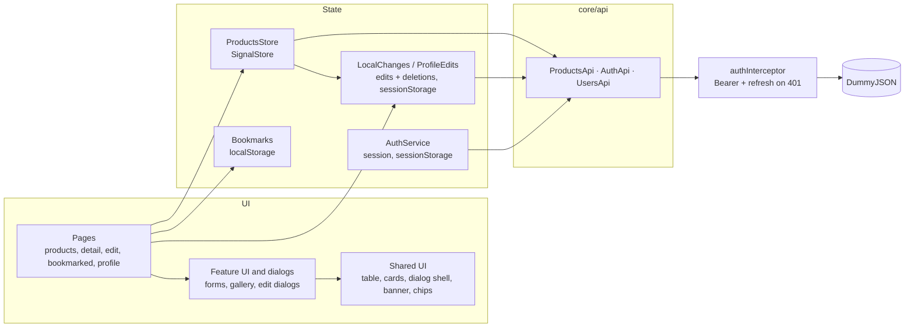

// for me> f2: Sign in: 13:24(start) - almost done: 13:45 (needs few style tweaks)
F3: Products list: 13:47(start) - almost done: 14:09
f4: Product details : 14:12 (start) -> 14:26"
f5: Product manipulation: 14: 28(start) -> 15:09
f6: Bookmarked: 15:11(start) -> 15;21
Refactor: 15:26 -> 15:29
Unit test+e2e: 20:52 -> 21:07 (one component for now)
restore 15-minute access token lifetime ~ <1m
readable rating in table and label-in-name for account button & a11y labels in table and account menu, validate stored local changes: 21:13 -> 21:24
User Profile> 21:30 -> 21:46
Improvements: 21:50->21:58
Readme update: 21: 59 -> 22:02

# Inventory Console

A small inventory management console built with Angular 22 on top of the public [DummyJSON](https://dummyjson.com/) API. A stock or catalog manager signs in, finds products, sees at a glance what is running low, edits or deletes products and keeps a personal list of products to watch.

> Technical test for the Frontend Engineer position (UX/UI department) at Hornetsecurity.

**Demo account:** `emilys` / `emilyspass` (any DummyJSON user works).

## Features

- **Sign in** with access and refresh tokens, protected routes, session expiry handling.
- **Product list:** search, category filter, sortable columns, pagination (10 / 25 / 50), all kept in the URL. Stock shown as a status (text, icon and color) and as a sortable quantity.
- **Product detail:** gallery, price and discount, stock, rating, description, shipping and return details, reviews.
- **Edit** in a dialog (or as a page from a direct link) with validation, an error summary and an unsaved-changes check.
- **Delete** with confirmation, an 8-second Undo and rollback if the request fails.
- **Bookmarked:** a personal working list, with its count in the side navigation.
- **Account menu:** theme (light / dark / system), language, user profile and sign out.
- **Translations ready:** every UI text comes from one English file (`public/i18n/en.json`, Transloco); adding a language means adding a file.
- **User profile:** account details with editable name, phone and job title.
- Loading, empty and error states on every screen with data; light and dark theme; responsive from 360 px; keyboard and screen reader support.

## How to run

Requirements: Node.js `^22.22.3 || ^24.15.0 || ^26` (Angular 22).

```bash
npm install
npm start          # http://localhost:4200, sign in with emilys / emilyspass
npm run build      # production build in dist/
npm run lint       # ESLint (angular-eslint)
npm test           # unit tests (Vitest)
npm run e2e        # end-to-end test (Playwright); first run: npx playwright install chromium
```

## Tech stack

| Area       | Choice                                                                                  |
| ---------- | --------------------------------------------------------------------------------------- |
| Framework  | Angular 22 (standalone, signals, zoneless, new control flow, OnPush)                    |
| UI library | Angular Material 3 + CDK                                                                |
| Forms      | Signal Forms (`@angular/forms/signals`), Reactive Forms on the sign-in page             |
| State      | NgRx Signals (SignalStore) for the list, `rxResource` for single reads                  |
| i18n       | Transloco 8 (`@jsverse/transloco`), runtime translations from JSON in `public/i18n/`    |
| Styling    | SCSS, Material 3 system tokens (`--mat-sys-*`) and app tokens (`--app-*`), mobile first |
| Tests      | Vitest + jsdom (unit), Playwright (E2E)                                                 |
| Tooling    | Angular CLI, ESLint, Prettier                                                           |

## Architecture

```
src/app/
  core/            app-wide singletons and state
    api/             all HTTP clients: api.config.ts (base URL), auth-api.ts, products-api.ts, users-api.ts
    auth/            session (AuthService), interceptor, guards, safe return URL
    bookmarks/       bookmarked ids (localStorage); used by the nav count, the button and the Bookmarked page
    products/        LocalChanges: the user's product edits and deletions (sessionStorage), read by every feature
    layout/          shell (top bar, side nav), account menu
    routing/         page title strategy, unsaved-changes guard
    i18n/            Transloco setup (provideI18n), HTTP loader, I18n helper for TypeScript, translated paginator labels
    theme/           light / dark / system theme
  shared/
    models/          interfaces.ts (all interfaces) and types.ts (all type aliases)
    ui/              reusable components, no feature logic:
      dialogs/         confirm-dialog (+ confirmDiscardChanges), dialog-shell (frame + close logic)
      banner/          inline error / info message, full width of its container
      form-error-summary/  error list with links to the fields
      back-link/       "‹ Products" link
      products-table/, product-cards/, products-skeleton/  the product list views (Products and Bookmarked)
      bookmark-button/, stock-chip/, product-image/, state-message/, undo-snackbar/
    utils/           small pure helpers (stock status, breakpoints)
    styles/          page headings, skeleton mixin
  features/        one folder per feature: auth, products, bookmarks, profile
    <feature>/
      pages/           routed screens
      dialogs/         dialogs opened from several places (product edit, profile edit)
      ui/              feature-only components (product form, gallery, toolbar, profile form)
      data-access/     stores and services (state, local changes, delete flow)
      utils/           validation schemas, mappers, constants
```



- Every route is lazy loaded; the shell is a layout route that wraps all signed-in pages.
- **API layer:** every HTTP call goes through a small, stateless client in `core/api/`. Services and stores above it own the state (session, local edits, current page), so the endpoints can be found, mocked or replaced in one place.
- **Types:** all of them live in two files, `shared/models/interfaces.ts` (object shapes: API responses, state, form models, dialog data) and `shared/models/types.ts` (unions and derived types such as `LoadStatus`, `SortField`, `ProductChanges = Partial<Pick<…>>`, `LoginResponse = AuthUser & AuthTokens`), grouped by area with section comments. Components and services only import them.
- **Where things go:** anything used by more than one feature lives in `shared/ui` (the product table, cards and skeleton are used by Products and Bookmarked; the bookmark button by the table, the cards and the detail page), so features never import from each other. App-wide state that several features or the shell need (session, theme, bookmarks, local product changes) lives in `core/`. `shared` depends only on `core` and Angular, never on a feature.
- **Pages, dialogs and UI:** pages are routed and talk to stores and services; `dialogs/` holds feature dialogs that load and save data (opened from several pages); shared UI components get data through `input()` and report through `output()`.
- **One dialog frame:** `DialogShell` owns closing for every form dialog: Esc, a click outside, the X button and the form's Cancel all go through `requestClose()`, which asks "Discard unsaved changes?" when the form reports changes. Feature dialogs only pass `hasUnsavedChanges`.
- **Shared form feedback:** `Banner` (error / info, full width, `role="alert"` or `"status"`) is used on the sign-in page and in both forms; `FormErrorSummary` lists the errors with links to the fields in both forms. Skeleton blocks use one SCSS mixin (`shared/styles/_skeleton.scss`).
- **`ProductDeletion` is a small facade:** it sits in `data-access` but also opens the confirmation dialog and the Undo snackbar, because the delete flow (confirm → hide → Undo window → `DELETE` → rollback on error) is one piece of logic used by the list, the cards, Bookmarked and the detail page. Keeping it in one service means every place behaves the same; components only call `confirm()` and `delete()`.

## Technical decisions

### Translations (i18n)

- **Library: Transloco** (`@jsverse/transloco` 8.4, latest stable; 9 is still alpha). Compared with Angular's built-in `@angular/localize`: that one translates at build time, so every language is a separate build and deployment, and switching language reloads the app. Transloco loads a JSON file at runtime, so the Language menu can switch without a reload, and one build serves all languages. Compared with ngx-translate: similar idea, but Transloco has standalone providers, `translateSignal()`, a testing module and lazy scopes per feature, and is actively maintained.
- **One file per language:** `public/i18n/en.json` (served as `/i18n/en.json`). Keys are grouped by where they belong: `app` (shell, skip link, navigation), `userMenu` (account dropdown), `buttons` (every button and button label), `validation.success` / `validation.error` (snackbar and announcement messages, form errors, sign-in and save errors), `states`, `dialogs`, `paginator`, then one group per feature: `auth`, `products` (with `fields`, `list`, `toolbar`, `detail`, `edit`, `delete`, …), `bookmarks`, `profile`. A text used in several places has **one key** and every place reads it (for example `products.fields.category` is the toolbar label, the table header and the form label; `buttons.signIn` is the button, the heading and the tab title). A small check confirms there are no missing, unused or duplicate texts.
- **Where texts are translated:** templates use the `transloco` pipe (also for `aria-label`, `placeholder`, `alt` and tooltips, so screen reader text is translated too). TypeScript (snackbars, live announcements, computed summaries, tab titles) uses a small `I18n` service: its `t()` reads a signal of the loaded translation, so a `computed()` text updates after a language switch. Config objects (route titles, nav items, sort options, theme options, stock status, confirm dialog data) and Signal Forms validation messages hold **keys**, translated where they are shown.
- **No flash of keys:** an app initializer loads the English file before the first render, so `translate()` can be used synchronously and `<html lang>` follows the active language.
- **Material texts:** `MatPaginatorIntl` is replaced with a translated version ("Items per page", "1 – 10 of 194", button labels).
- **Plurals:** two keys (`countOne` / `countOther`) chosen in code, to avoid another plugin for now (see improvements).
- **Language names** in the menu stay in their own language (English, Deutsch, Македонски) and are not translated, so users can always find theirs. German and Macedonian stay "Coming soon" until their files exist.
- **Not tied to text:** the "focus the next row after a delete" helper used to find buttons by their English `aria-label`; it now uses a `data-row-actions` attribute, so it keeps working in any language.

### Design system

- **Angular Material 3 instead of Spartan UI (shadcn for Angular):** mature, accessible table, sort and paginator out of the box, and a theming API based on M3 tokens. With the custom palette and Inter it does not look generic, and the saved time went into UX details.
- **Theme:** palette generated from the seed color Signal Blue `#1E63D6` with the official `theme-color` schematic; Inter font; light and dark theme from the same tokens via `light-dark()`. Blue is the calm, trusted color of admin and security tools and stays far from the green / amber / red stock statuses. Success and warning colors are app tokens (`--app-*`) because Material 3 has none. Only tokens are used in styles, no hard-coded colors, spacing or radii.
- **Design process:** low-fidelity wireframes first, then a design system and the screens in [Figma](https://www.figma.com/design/s1SZiP9cZpyqIjp4nBXkto/Inventory-Console) (colors for both themes, type scale, components bound to the same tokens as the code).

- **Motion:** Material 3 durations and easing curves as tokens (`--app-motion-*`, `--app-easing-*`). On the sign-in page the card fades in, and messages slide open and closed so the fields move smoothly instead of jumping. Built with Angular's `animate.enter` / `animate.leave` and plain CSS (no `@angular/animations`); the height animates with `grid-template-rows: 0fr → 1fr`. With "Reduce motion" turned on in the OS, animations are switched off.

### Authentication and security

- **Session:** sign-in against `/auth/login`. User and tokens are kept in `sessionStorage`: a reload keeps the user signed in, closing the tab signs them out. Access tokens live 15 minutes (`expiresInMins: 15`, short-lived as OWASP recommends).
- **Interceptor:** adds the Bearer token; on a `401` it refreshes once (parallel requests share one refresh call) and repeats the request. If the refresh fails, the session has expired and the user returns to sign-in with a `returnUrl` and a "Your session expired" message.
- **Guards:** `authGuard` protects every signed-in page, `guestGuard` keeps signed-in users away from `/login`. `returnUrl` accepts in-app paths only, which prevents open redirects.
- **Sign-in errors:** "user does not exist" and "wrong password" share one message, so the form does not reveal which usernames exist. Network failures get their own message. Field errors are shown on submit and focus moves to the first invalid field. The card stays anchored at the top; a message grows it downwards instead of moving the form.
- **Untrusted storage:** data read back from `sessionStorage` / `localStorage` is checked before use, so old or broken data falls back to an empty state instead of crashing the app.
- **Only the data the screen needs:** `/auth/me` also returns bank card, SSN, IP and health data; the `UserProfile` interface types only the work-related fields and nothing else is shown.

### Product list

- **State:** NgRx SignalStore (`ProductsStore`) holds the query, the current server page, the total and a load status. `rxMethod` + `switchMap` cancels an outdated request when the query changes quickly. The store is provided by the page, so its state lives as long as the page.
- **URL as the source of truth:** search, category, sort, order, page and page size live in the query string (`?q=phone&sort=price&page=2`). Links are shareable, a reload restores the same view and Back / Forward work. Starting a search adds a history entry; refining it replaces that entry. "Back to products" on the detail page returns to the same search, sort and page.
- **Search and category:** DummyJSON has separate endpoints for search and category and cannot combine them. Search therefore looks across all categories, and choosing a category clears the search (and the other way round). Paging and sorting run on the server.
- **Stock:** the API cannot filter by stock, but it can sort by any field, so sorting by quantity (low to high) brings low and out-of-stock items to the top. In the table, stock is split into **Stock** (status chip: text, icon and color, never color alone; 0 = out of stock, 1–10 = low) and **Quantity** (right-aligned, sortable), so quantities line up and are easy to compare.
- **Smaller responses:** list requests use `select` to fetch only the fields the list shows.
- **States:** skeleton on the first load, a thin progress bar while a new page loads (rows stay visible), an empty state with "Clear filters", an error state with "Try again". A live region announces the number of results.
- **Responsive:** a table from 1200 px (eight columns next to the side nav); below that, cards with a "Sort by" select. Side nav from 840 px, a drawer below.

### Product detail

- **`rxResource`** instead of a store for a single read: loading, value and error as signals, refetch when `:id` changes. A `404` (or a product deleted in this session) shows "Product not found".
- **Accessibility:** the tab title becomes the product name and focus moves to the heading; gallery thumbnails are one tab stop with arrow keys; the rating is read as "Rating 4.6 out of 5". The main image uses `NgOptimizedImage` with `priority`, thumbnails are lazy loaded.

### Editing and deleting

- **Local changes layer:** DummyJSON answers `PATCH` and `DELETE` as if they succeeded but never stores them. `LocalChanges` keeps the user's edits and deletions in `sessionStorage` and applies them on top of every server response (list, detail, edit form, bookmarks).
- **Optimistic update with rollback:** an edit shows everywhere at once and the `PATCH` runs in the background. If it fails, the edit is rolled back and the form shows an error, keeping the user's input.
- **Full pages after a delete:** the server still counts deleted products, so its pages are shifted. While there are local deletions, the list fetches from the first item to the end of the current page plus the number of deletions (`limit = page × size + deleted`, `skip = 0`) and cuts the page in the store, so every page stays full and nothing is skipped or shown twice. The total subtracts every deletion in the unfiltered list; with a search or category only the deletions in the loaded range are known, so the count can be slightly high until those pages are opened (a backend would return the exact count). On a large catalog this request grows with the page number; a real backend would handle deletions itself.
- **Delete: confirmation and Undo:** every delete asks "Delete “…”?" first (Cancel has the initial focus). After confirming, the product disappears at once and a snackbar offers Undo for 8 seconds; the timer pauses while the pointer or keyboard focus is on it. `DELETE` is sent only when the window closes without Undo; if it fails, the product comes back with a message. After a delete from the list, the page stays where it was and focus moves to the row that takes the deleted row's place (rows are tracked by id, so the table keeps its DOM).
- **Signal Forms:** stable in Angular 22 and a natural fit for a signals-first app: the form model is a `linkedSignal` seeded from the product, and the rules are a separate, reusable `schema` (`product-form.schema.ts`). Material 22 supports it directly (`matInput` and `mat-select` read the `[formField]` state). Rules: title, description, category, price, discount and stock are required; price > 0, discount 0–100, stock a whole number ≥ 0; brand is optional.
- **Validation UX:** errors appear after the first save attempt and then update live; an error summary links to the fields; focus moves to the first invalid field; the button shows "Saving…".
- **Dialog or page:** inside the app, Edit opens the form in a dialog so the user keeps their place in the list; a direct link to `/products/:id/edit` opens the same form as a page. Both reuse one `ProductForm`; the dialog frame (`DialogShell`) is shared.
- **Unsaved changes:** leaving a changed form asks "Discard unsaved changes?" ("Keep editing" has the initial focus). On the page this is a `canDeactivate` guard plus the browser prompt on tab close; in the dialog, Esc, the backdrop and the close button go through the same check.

### Bookmarked

- A personal working list. Ids live in `localStorage` (not `sessionStorage`): a bookmark should survive closing the tab.
- DummyJSON has no favorites resource and cannot fetch several ids at once, so the page loads the catalog once with list fields only (`limit=0&select=…`, ~194 small items) and keeps the bookmarked ones: one request regardless of the number of bookmarks, always current prices and stock. A real backend would offer `?ids=` or a bookmarks endpoint.
- Reuses the product table, cards, skeleton, edit dialog and delete flow; search, sorting and pagination (10 / 25 / 50) run in the browser, and the page stays valid when the list shrinks (unbookmark, delete, search). The count in the side nav leaves out deleted products (they stay bookmarked, so Undo brings them back). One `BookmarkButton` (filled icon + `aria-pressed`, tooltip) is used in the table, the cards and the detail page; the side nav shows the count with screen reader text ("3 products").

### Account menu and profile

- **Account menu:** the avatar opens one menu for everything about the user: name and email, **Theme** (Light / Dark / System as radio items; System follows the OS, an explicit choice is stored in `localStorage`), **Language** (English; German and Macedonian shown as "Coming soon" until their translation files exist; see Translations), **User profile** and **Sign out**. The theme control lives only here, so there is one place for it.
- **User profile (`/profile`):** photo with an initials fallback, name, job title and company, username and role, plus contact, work and location cards. **Edit profile** opens the shared dialog with first name, last name, phone and job title (same validation UX as the product form). `PATCH /users/{id}` is simulated, so `ProfileEdits` keeps the changes per user in `sessionStorage` and applies them optimistically on the profile page and in the account menu.
- **Not editable on purpose:** username (used to sign in), email (would need verification), role (only an administrator may change permissions) and company. There is no password change: DummyJSON has no endpoint for it, and a form that only pretends to work would be misleading.

### Accessibility

- Skip link to the main content, landmarks, `aria-current` on the active link, visible focus ring, page title per route, `prefers-reduced-motion` respected.
- Every control has an accessible name (also checked by the E2E selectors); live regions announce results, deletes and restores without double announcements.
- Checked with axe-core (WCAG 2.2 AA) on every screen at 360, 768, 1024 and 1440 px in both themes: no contrast, ARIA or target size violations, and no horizontal scroll.

### Performance

- Lazy-loaded routes, zoneless change detection with OnPush, `select` for small list responses, `NgOptimizedImage`, one shared refresh request for parallel `401`s, and outdated list requests cancelled with `switchMap`.
- **Initial bundle: 389 kB raw / 108 kB transferred** (production build). The unsaved-changes guard sits in the eagerly loaded route config, so it imports the dialog code on demand; before, a static import pulled `MatDialog` and the CDK overlay into the initial bundle (540 kB / 135 kB, over the 500 kB budget).

## Testing

```bash
npm test -- --watch=false   # unit tests (Vitest, through `ng test`)
npm run e2e                 # end-to-end test (Playwright); starts `ng serve` if it is not running
```

- **Unit tests (33, in `features/products/data-access/` and `core/products/`):**
  - `products-store.spec.ts` – loads a page; keeps pages full after a delete with no product shown twice; counts a deletion outside the loaded page in the total; removes a row at once and brings it back on Undo; empty last page; "no results"; keeps rows while the next page loads; ignores an outdated response (`switchMap`); keeps the query after an error so "Try again" repeats it.
  - `core/products/local-changes.spec.ts` – optimistic edit and rollback to the previous value; delete hides without calling the API; failed `DELETE` brings the product back; survives a reload; broken or old storage data (invalid JSON, `null`, wrong shape) starts empty instead of crashing.
  - `product-deletion.spec.ts` – confirm only on "Delete" (Cancel, Esc, click outside = no); Undo restores and never sends `DELETE`; timeout sends `DELETE`; failed `DELETE` restores with a message.
  - `product-query-params.spec.ts` – URL → query and back; invalid or hand-edited values fall back to defaults; search wins over category; spaces-only search; defaults are left out of the URL.
  - `ProductDeletion` runs with the real `en.json` through `provideI18nTesting()` (Transloco testing module), so the tests also check the translated messages.
  - `ProductsApi` and Material dialogs / snackbars are fakes; the real `LocalChanges` runs on jsdom `sessionStorage`, so the store and the local layer are tested together.
- **E2E – main flow** (`e2e/product-flow.spec.ts`): sign in → search → detail → edit in the dialog → delete with confirmation → Undo; checks that the `PATCH` was sent and the `DELETE` was not.
- **Why mocks:** DummyJSON does not store changes and its data can change, so the E2E test answers every API call from fixed fixtures (`e2e/fixtures/`, `e2e/support/mock-api.ts`). It is fast, stable and works offline.
- **Selectors by role and label** (`getByRole`, `getByLabel`), never CSS classes: if a control loses its accessible name, the test fails, so the E2E test is a small accessibility check too.

## API limitations and how the app handles them

| DummyJSON limitation                                         | In the app                                                                      |
| ------------------------------------------------------------ | ------------------------------------------------------------------------------- |
| `POST` / `PATCH` / `DELETE` are simulated, nothing is stored | Local changes layer with optimistic updates and rollback (products and profile) |
| Search and category cannot be combined                       | Search across all categories; choosing one clears the other                     |
| No stock filter                                              | Sort by quantity                                                                |
| No request for several ids                                   | Bookmarks load the catalog once with small fields                               |
| No password change or image upload                           | Not offered (see improvements)                                                  |

## Possible improvements

- Store tokens in `HttpOnly` cookies set by a real backend instead of `sessionStorage` (not readable by injected scripts).
- Password change, password reset and sign-up (DummyJSON has no endpoints for them; `/users/add` does not persist users).
- Product images and profile photo upload: need a backend with file storage.
- Add product: DummyJSON has `POST /products/add` (simulated); `ProductForm` and `productFormSchema` are reusable for it.
- Translations: add `de.json` and `mk.json` (only the files, the setup and the Language menu are ready); ICU plurals with `@jsverse/transloco-messageformat` (Macedonian and German plural rules differ from English); `LOCALE_ID` per language for currency, number and date formats; typed keys or `transloco-keys-manager` to find missing keys in CI; lazy translation scopes per feature when the file grows.
- Search within a category and a real stock filter need a backend that combines filters (and returns facets such as brands).
- Specific messages for rate limiting (`429`) and timeouts.
- A keyboard shortcut to reach Undo in the snackbar.
- More unit tests (forms, guards, interceptor) and E2E tests for Bookmarked, the profile and error states.

## Time log (personal notes – remove before submission)

Start = prompt sent to Claude, end = feature committed and pushed (times from git history, CEST).

| Task                        | Started | Finished | Duration |
| --------------------------- | ------- | -------- | -------- |
| Feature 1 – Setup and shell | 13:04   | 13:22    | 18 min   |
| Feature 2 – Authentication  | 13:24   | 13:45    | 21 min   |
| Feature 3 – Products list   | 13:47   | 14:09    | 22 min   |
| Feature 4 – Product detail  | 14:12   | 14:26    | 14 min   |
| Feature 5 – Edit and delete | 14:29   | 15:09    | 40 min   |
| Feature 6 – Bookmarked      | 15:11   | 15:21    | 10 min   |
| Refactor – API layer, types | 15:21   | 15:29    | 8 min    |
| Feature 7 – Tests           | 20:52   | 21:10    | 18 min   |
| Feature 8 – A11y review     | 21:13   | 21:24    | 11 min   |
| Account menu and profile    | 21:28   | 21:46    | 18 min   |
| Stock / quantity, sign-in   | 21:50   | 21:58    | 8 min    |
| README update               | 21:59   | 22:02    | 3 min    |
| Sign-in animations          | 22:03   | 22:07    | 4 min    |
| Bundle size check           | 22:08   | 22:11    | 3 min    |
| Architecture refactor       | 22:15   | 22:23    | 8 min    |
| Self-review fixes           | 22:32   | 22:36    | 4 min    |
| Keep position after delete  | 22:37   | 22:39    | 2 min    |
| i18n – Transloco, English   | 22:45   |          |          |

## Time spent

| Part                                        | Time |
| ------------------------------------------- | ---- |
| Feature 1 – Setup and shell (started 13:04) |      |
